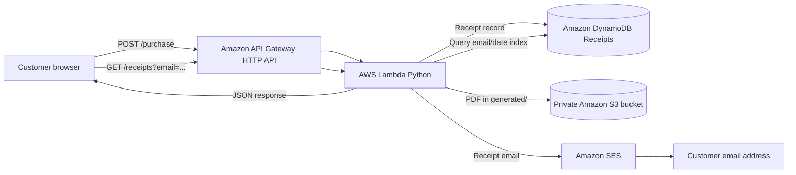

# AWS Serverless Receipt Generator

A small demo storefront that accepts a product selection, quantity, and customer email, then creates and emails a purchase receipt using AWS serverless services.

> **Demo only:** This project does not charge payments or provide customer authentication. Do not use it to process real purchases or store real customer data without adding payment verification and authentication.

## Demo link

- **Website:** https://d11eajog8p3vb7.cloudfront.net/
- **Source code:** This repository

Do not use a `file:///C:/...` address as a public demo link; it only opens on your computer. If the frontend is not hosted, link to the repository and add screenshots.

## How it works

1. The customer selects a sample product and quantity and enters an email address.
2. The browser sends the order to the API Gateway HTTP API.
3. AWS Lambda validates the request, looks up the product price on the server, calculates the total, and generates a PDF receipt.
4. Lambda stores the receipt record in DynamoDB and the PDF in the private S3 `generated/` prefix.
5. Amazon SES emails a receipt link to the email entered at checkout. The S3 download link expires after 24 hours.



## Features

- Demo checkout page with product, quantity, and customer email fields.
- Server-side product prices and order-total calculation in Lambda.
- PDF receipt generation.
- Receipt records stored in DynamoDB.
- Generated PDF receipts stored in S3 and shared using an expiring signed link.
- SES email delivery to the address supplied by the customer.
- Receipt lookup by email through a DynamoDB global secondary index.

## AWS services

- **Amazon API Gateway HTTP API:** Receives checkout and receipt-lookup requests.
- **AWS Lambda (Python):** Validates orders, calculates totals, creates PDFs, stores data, and sends emails.
- **Amazon DynamoDB:** Stores receipt records in the `Receipts` table.
- **Amazon S3:** Stores generated receipt PDFs under `generated/`. Keep the bucket private.
- **Amazon SES:** Sends the receipt email from a verified sender identity.

## API routes

| Method | Route | Purpose |
|---|---|---|
| `POST` | `/purchase` | Creates a demo order, receipt record, PDF, and email |
| `GET` | `/receipts?email=customer@example.com` | Returns up to 50 receipts for the supplied email |

The Lambda code also accepts `POST /receipts` as a migration alias if that route remains configured in API Gateway.

## Repository layout

```text
aws-receipt-generator/
├── README.md
├── frontend/
│   └── index.html
├── backend/
│   └── lambda_function.py
└── docs/
    └── images/
        ├── checkout-page.png
        ├── receipt-email.png
        └── architecture.png
```

## Configuration

Set the Lambda environment variables in AWS. Put your own values in the AWS console; do not publish private account information or credentials in this README.

| Variable | Purpose |
|---|---|
| `DYNAMODB_TABLE` | DynamoDB table name |
| `S3_BUCKET` | Private S3 bucket for generated receipts |
| `S3_RECEIPT_PREFIX` | Receipt object prefix, such as `generated/` |
| `SES_SENDER_EMAIL` | SES-verified sender address |
| `EMAIL_INDEX` | Email/date DynamoDB index name |
| `ALLOWED_ORIGIN` | Exact website origin allowed by CORS |

The frontend needs the API Gateway invoke URL as its API base URL. The JavaScript appends `/purchase` and `/receipts` to that base URL, so do not add either route to the base value.

## DynamoDB schema

The existing `Receipts` table uses:

- Partition key: `receipt_id` (String)
- Sort key: `date` (String)

The email lookup uses a global secondary index named `customer-email-date-index` with `email` as its partition key and `date` as its sort key. Confirm your table and index names match the Lambda configuration before testing.

## Local setup and testing

1. Place the website file at `frontend/index.html` and the Lambda handler at `backend/lambda_function.py`.
2. Set the frontend API base URL to your API Gateway invoke URL.
3. Configure API Gateway with `POST /purchase` and `GET /receipts`, both integrated with the Lambda function.
4. Configure API Gateway CORS and the Lambda `ALLOWED_ORIGIN` for the exact frontend origin. For local testing, this might be `http://localhost:5500`.
5. Serve the frontend over HTTP with Live Server or another local web server. Do not open it using `file:///...`.
6. Deploy the Lambda code and configure its environment variables and execution-role permissions.
7. Use an SES-verified recipient for the first test if SES is still in sandbox mode.
8. Verify the test receipt in DynamoDB, the PDF in the S3 `generated/` prefix, and the email in the recipient inbox.


## Security and project limits

- The checkout is a demo order flow; it does not verify payment or charge a card.
- The email address is not authentication. The receipt lookup route accepts an email query parameter, so do not expose real customer receipts through this demo without adding authentication and authorization.
- CORS is not API authentication. A public API endpoint can be called by scripts as well as by this webpage.
- Keep the S3 receipt bucket private. Do not enable public access to receipt files.
- Never commit AWS access keys, secret keys, session tokens, `.env` files, real customer emails, real receipts, or production database exports.
- Use fake data in screenshots. Hide account identifiers and any personal or credential information before uploading them.
